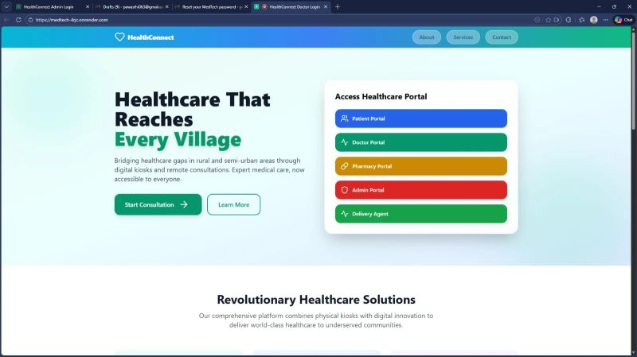
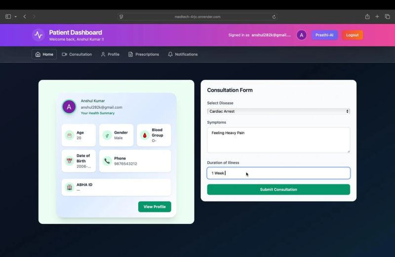
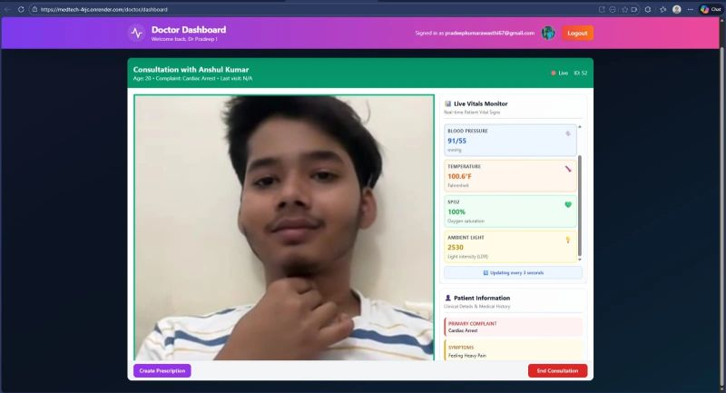
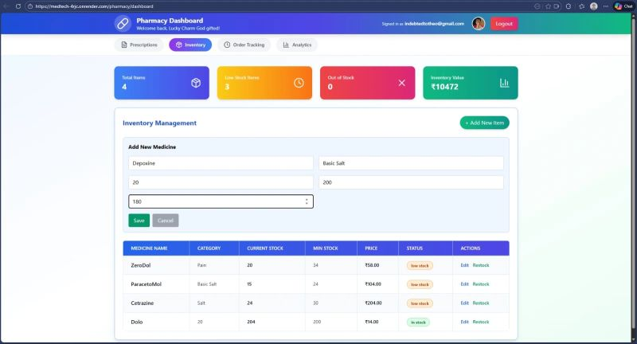

# MedTech

An IoT telemedicine kiosk. A patient walks into a pharmacy, campus, or clinic, records vitals, and consults a doctor remotely. It started as a Smart India Hackathon idea and became a working platform.

[Live demo](https://medtech-4rjc.onrender.com)

## Demo

| Home | Patient |
| --- | --- |
|  |  |
| Live consult | Pharmacy |
|  |  |

## What it does

- Separate portals for patients, doctors, pharmacies, admins, and delivery
- Consultation requests, doctor assignment, and video calls
- Live vitals on the call: heart rate, blood pressure, temperature, SpO2
- Digital prescriptions and pharmacy inventory
- Prasthi, an in-app health assistant

The backend runs on AWS EC2. Patient data sits in Neon PostgreSQL. The public demo is on Render.

## Stack

React · TypeScript · Tailwind · FastAPI · PostgreSQL · Socket.IO

## Run locally

```bash
git clone https://github.com/Pradeep-gif-hub/MedTech.git
cd MedTech

cd healthconnect-backend
pip install -r requirements.txt
python -m uvicorn main:app --reload

cd ../healthconnect-frontend
npm install
npm run dev
```

Set `GOOGLE_CLIENT_ID` before starting the backend if you want Google sign-in. `setup-local.sh` walks through that.

## Team

Pradeep Kumar Awasthi, with Vishal, Hardik Agarwal, Paarth Lalit, Gunjan Saini, and Nikita.

[GitHub](https://github.com/Pradeep-gif-hub) · [LinkedIn](https://www.linkedin.com/in/pradeep-kumar-awasthi-9313a2280/)
